<!-- ===== Singularity: title card ===== -->

  <picture>
    <source media="(prefers-color-scheme: dark)" srcset="https://raw.githubusercontent.com/ZPatelDBS/ZPatelDBS/output/singularity-hero-dark.svg" />
    
  </picture>

  

  
  

> **Mission brief.** Full-stack developer building enterprise web applications in healthcare and identity: Next.js, Node.js, PostgreSQL and Redis on the modern side, ASP.NET MVC on the classic side.
>
> **Current objective.** Learning Power Apps, Power Automate and Power BI to automate real business processes.

## 🚀 What I do

- 🏗️ Building full-stack web applications and enterprise systems
- 🏥 Working on healthcare and identity software
- 🔌 Designing APIs, integrations and database schemas
- ⚡ Currently learning **Power Apps, Power Automate & Power BI**
- 🤖 Using AI-assisted tools to build and ship faster

## 🛠️ Tech stack

  
    
  

  
  
  
  
  

## 🛰️ Mission telemetry

  <picture>
    <source media="(prefers-color-scheme: dark)" srcset="https://raw.githubusercontent.com/ZPatelDBS/ZPatelDBS/output/singularity-telemetry-dark.svg" />
    
  </picture>

## 👾 Player 1

  <picture>
    <source media="(prefers-color-scheme: dark)" srcset="https://raw.githubusercontent.com/ZPatelDBS/ZPatelDBS/output/pacman-arcade-dark.svg" />
    
  </picture>

  <picture>
    <source media="(prefers-color-scheme: dark)" srcset="https://raw.githubusercontent.com/ZPatelDBS/ZPatelDBS/output/pacman-scoreboard-dark.svg" />
    
  </picture>

  <picture>
    <source media="(prefers-color-scheme: dark)" srcset="https://raw.githubusercontent.com/ZPatelDBS/ZPatelDBS/output/pacman-end-dark.svg" />
    
  </picture>

Artwork adapted from <a href="https://github.com/Dr-At0mic/README-Templates">README Templates</a> by Anandhu Suresh (GPL-3.0), regenerated nightly from live GitHub data.

