<!-- ===== Animated header ===== -->

  

  
  

<!-- ===== Animated terminal ===== -->

  

## 🚀 What I do

- 🏗️ Building full-stack web applications and enterprise systems
- 🏥 Working on healthcare and identity software
- 🔌 Designing APIs, integrations and database schemas
- ⚡ Currently learning **Power Apps, Power Automate & Power BI**
- 🤖 Using AI-assisted tools to build and ship faster

## 🛠️ Tech stack

  
    
  

  
  
  
  
  

## 🏆 All-time contributions

  

## 📊 GitHub stats

  
  

  

## 🐍 Watch my contributions get eaten

<picture>
  <source media="(prefers-color-scheme: dark)" srcset="https://raw.githubusercontent.com/ZPatelDBS/ZPatelDBS/output/github-snake-dark.svg" />
  <source media="(prefers-color-scheme: light)" srcset="https://raw.githubusercontent.com/ZPatelDBS/ZPatelDBS/output/github-snake.svg" />
  
</picture>

<!-- ===== Animated footer ===== -->

